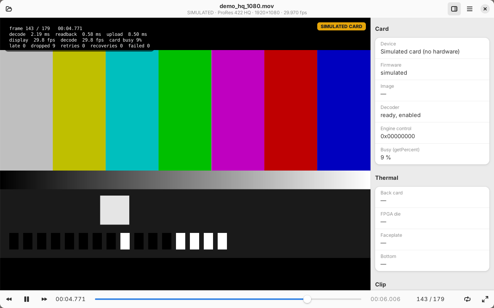

# Afterburner Player (abplayer-gtk)

A GNOME desktop video player and test tool for the Apple Afterburner card. It runs
natively on Wayland and is built with GTK4 and libadwaita.

Every frame is decoded by the card through `/dev/afterburner0` (see `linux-driver/afterburner`).
The app parses the MOV container, sends the exact packet bytes to the card, and shows the
card's output with OpenGL. **There is no software ProRes decoder in it.** If the card can't
decode a frame, you see an error, not a fallback picture.



*The screenshot uses the built-in simulated card (note the badge). The simulator paints a test
pattern with 75 % colour bars, a luma ramp, a moving box and the frame number in binary.*

## Build and run on Arch (GNOME, Wayland)

```sh
sudo pacman -S --needed base-devel gtk4 libadwaita libepoxy   # ffmpeg too, for `make check`

cd linux-driver/afterburner
make && sudo insmod afterburner.ko          # driver first: creates /dev/afterburner0 (mode 0666)

cd userspace/abplayer-gtk
make
./abplayer-gtk ../../../../dev/testmedia/prores422.MOV
```

`make install` installs the binary, the desktop entry and the icon under `~/.local`, so
**Afterburner Player** shows up in the GNOME app grid and in Nautilus's "Open With" list for
`.mov` files. Use `make install PREFIX=/usr/local` for a system-wide install and
`make uninstall` to remove it.

No card at hand? Run `./abplayer-gtk --simulate clip.mov`, or click **Use Simulated Card**
on the "card unavailable" page.

## Using it

Open a clip with the button, **Ctrl+O**, drag-and-drop, or a command-line argument. Before the
card sees anything, the app validates **every** sample. It checks that the sample lies inside
the file, that the size in its frame header matches the sample table, that it carries the
`icpf` tag, that its dimensions match the first frame, and that its chroma is 4:2:2. This
extends abplayer's P-B1 self-check, which catches the stsc/offset-table class of bug before it
can wedge the engine.

| Key | Action |
|---|---|
| Space / K | play / pause (at the end, play restarts from frame 0) |
| ← / → | previous / next frame (pauses; ProRes is intra-only, so every frame is a real decode) |
| Shift+← / Shift+→ | back / forward one second |
| Home / End | first / last frame |
| F / F11, Esc | fullscreen, leave fullscreen (bars auto-hide; move the mouse to show them) |
| I | statistics overlay |
| F9 | card & statistics panel |
| L | loop |
| B | run at card speed (benchmark: decoder never waits for the display) |
| Ctrl+S / Ctrl+Shift+S | save frame as PNG / raw card output |
| Ctrl+Q | quit |

The main menu also has:

- **Colour Matrix**: Automatic (from the `colr` box, else the ProRes frame header, else
  BT.709 for HD+ and BT.601 for SD), BT.601, BT.709 or BT.2020, plus a full-range override.
- **Card**: *Start Decoder* / *Stop Decoder* (`AB_IOC_START` / `AB_IOC_STOP`; a stopped
  decoder is started again automatically on the next frame) and *Hard Reset (FLR)*
  (`AB_IOC_RESET`, asks for confirmation first). The driver refuses the reset on cards without
  PCIe FLR, which per plan2 B2 includes this one. *Use Simulated Card* switches backends.
- **Save Frame as PNG** writes exactly what the GL path rendered, at native resolution.
- **Save Raw Card Output** writes the card's own bytes for the frame: H rows of `stride`
  bytes in `[U,Y0,V,Y1]` order, the same layout as `abplayer --dump-dir`. Compare it with the
  existing tools:
  ```sh
  ffmpeg -i clip.mov -vf "select=eq(n\,370)" -frames:v 1 -pix_fmt yuv422p -f rawvideo ref.yuv
  python3 ../../tests/compare_card_ref.py clip_frame000370_card_uyvy.yuv ref.yuv 1920 1080
  ```

### What the overlay and panel show

- **decode**: ring → batch-channel completion on the card. **readback**: copying the
  frame out of the uncached DMA mapping. **upload**: GL texture upload and conversion.
- **display / decode fps**: frames shown per second, and frames the card completed per second.
- **card busy**: `AB_IOC_GET_PERCENT`, the kext-exact decode duty cycle, sampled once a second.
- **late / dropped**: a frame is *late* when the card couldn't deliver it by its slot, and
  playback then re-times from that frame. A frame is *dropped* when it was decoded but
  superseded before the display got to it. In card-speed mode most frames are dropped by
  design.
- **retries / recoveries / failed**: use of the recovery ladder (see below).
- The panel adds firmware, image type, decoder state, `engine_ctrl`, thermal sensors (from
  `/sys/class/afterburner/afterburner0`), clip details including the card's buffer geometry,
  a decode-time histogram and the GL renderer.

When a clip is closed, a summary in the style of abplayer's stats block is printed to stdout.
`AB_DEBUG_TIMING=1` logs every late or dropped presentation with its tick timing.

### Scripted checks

```sh
# decode frame 370 on the card, render it through the display path, save it, exit
./abplayer-gtk --frame 370 --export-png /tmp/f370.png clip.mov
```

Other options: `--simulate`, `--frame N`, `--paused`, `--loop`, `--card-speed`, `--panel`
(see `--help`).

## How it drives the card

```
UI thread ──seek/play──▶ decode thread ──card_decode()──▶ /dev/afterburner0
    ▲                          │ pread packet → stage → mmap'd input region
    │ GdkFrameClock tick       │ SUBMIT_ASYNC → WAIT_COMPL (batch channel, status>>1 ≥ 1)
    │ picks frame by PTS       │ copy H×stride out of the UC output region
    └──── 4-slot queue ◀───────┘ (1 on screen + 3 decoded ahead)
GL: UYVY texture ─(pass 1, 1:1)─▶ RGB FBO + mipmaps ─(pass 2, aspect-fit)─▶ window
```

- The ioctl sequence ports `userspace/abplayer.c`'s proven path (FINDINGS §41–43). It uses
  the exact `in_len`, `out_len = ceil(W·2/64)·64 × ceil(H/16)·16`, auto-`START` when the
  decoder isn't ready, and the same recovery ladder: second `WAIT_COMPL` window → full
  `UNBIND_ALL` / `START` / rebind / resubmit → three 2 s windows → report failure. On close
  it sends `AB_IOC_STOP`, so the card idles quiesced, as the kext does.
- Every mapping of the DMA regions is torn down **before** `BIND_FRAME`, `UNBIND_ALL` or
  `RESET`. Those ioctls free the coherent pages, and `remap_pfn_range` mappings don't hold
  page references.
- The driver keeps one global binding, so the app takes an exclusive `flock` on the
  device node — the same lock `abplayer` and `abctl`'s mutating commands take. Whichever
  client comes second reports "in use" instead of rebinding under the first.
- Card output is `[U,Y0,V,Y1]`, i.e. **UYVY**, as pixel-verified in FINDINGS §35/§41. It is
  uploaded unconverted as an RGBA8 texture of ⌈W/2⌉×H texels, using
  `GL_UNPACK_ROW_LENGTH` to handle the padded stride. Pass 1 converts each pixel exactly
  once (even pixels use their co-sited chroma; odd pixels average the two neighbours). Pass 2
  scales with trilinear filtering, so 4K downscales cleanly.

## Tests: `make check`

No card is needed. The tests generate ProRes clips with ffmpeg and check:

- the parser and self-check on all four 422 profiles, an odd width (322×180 → stride 704,
  rows 192, as in FINDINGS §35.3), faststart with a `colr` box, and interlaced with a 4:3
  PAR;
- a sparse 4.5 GiB file with a 64-bit `mdat` (the layout of any long 4K recording) and a
  clip whose audio track comes before the video track;
- that ProRes 4444, 4444 XQ, MPEG-4, a truncated file and a corrupted `stsz` entry are
  rejected;
- 6 000 fuzzed parses under ASan/UBSan;
- with a Wayland or X display, the full display path. Real ProRes frames decoded by ffmpeg
  are replayed through the simulator in the card's padded layout (`AB_SIM_UYVY`), rendered
  by the GL path, read back with `--export-png` and compared with an independent model of the
  conversion. This currently matches **bit-exactly** (max diff 0) at 1920×1080 BT.709 and
  322×180 BT.601.

## Status and limits

- **The hardware path has not run on a card yet.** It is a port of abplayer's verified
  sequence, but everything here was exercised with the simulator only (on Wayland under
  weston, GTK 4.14 / libadwaita 1.5). First runs on the Mac Pro are the real test.
- Video only: no audio playback.
- ProRes 422 Proxy, 422 and HQ are verified decodes on fw 2.62. 422 LT (`apcs`) is accepted
  but has never been run on the card, and the app shows a notice when you open one. 4444 and
  RAW are rejected up front, because the engine acknowledges them but emits nothing (FINDINGS
  §36–37).
- Interlaced clips are shown as the card delivers them; field handling is untested.
- Fragmented MP4 (`moof`) is not supported. Remux with `ffmpeg -c copy -movflags +faststart`.
